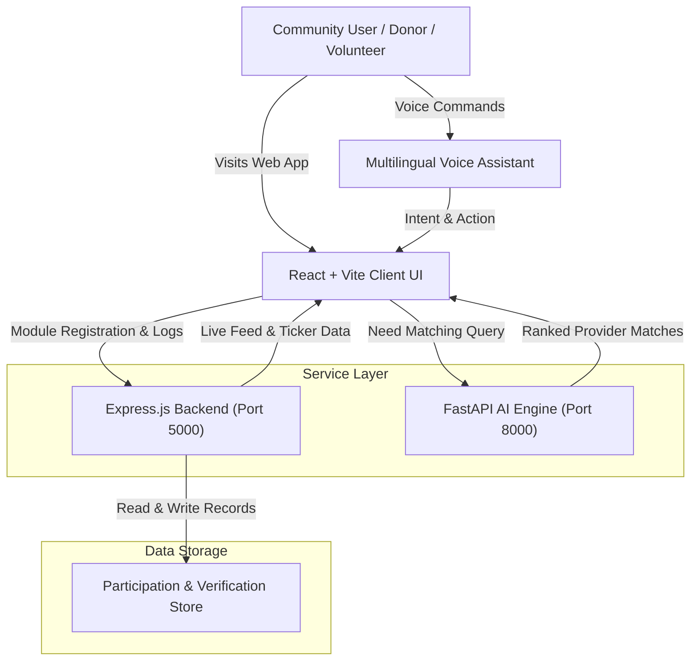
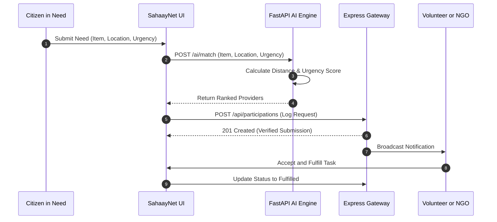
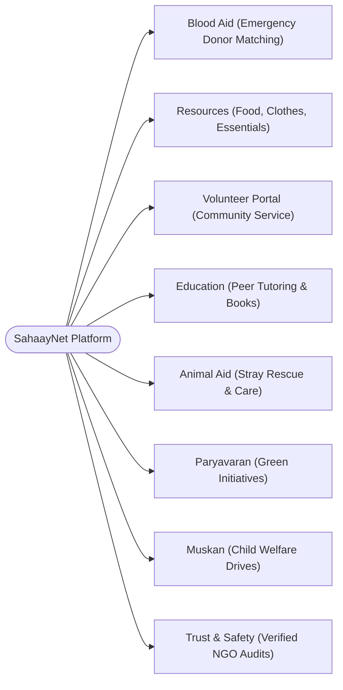

# SahaayNet 🤝
### *AI-Powered Community Assistance & Humanitarian Aid Platform*

[](https://reactjs.org/)
[](https://fastapi.tiangolo.com/)
[](https://nodejs.org/)
[](https://opensource.org/licenses/MIT)
[](http://makeapullrequest.com)

---

## 📖 Table of Contents
- [Project Overview](#-project-overview)
- [The Problem We Solve](#-the-problem-we-solve)
- [System Architecture & Flowchart](#-system-architecture--flowchart)
  - [High-Level System Flowchart](#1-high-level-system-flowchart)
  - [AI Matching Engine Workflow](#2-ai-matching-engine-workflow)
  - [Module Ecosystem Architecture](#3-module-ecosystem-architecture)
- [Core Modules Breakdown](#-core-modules-breakdown)
- [Multilingual & Voice Assistance](#-multilingual--voice-assistance)
- [Technology Stack](#-technology-stack)
- [Repository Structure](#-repository-structure)
- [API Reference](#-api-reference)
- [Getting Started & Local Setup](#-getting-started--local-setup)
- [Docker & Deployment Guide](#-docker--deployment-guide)
- [Roadmap & Future Scope](#-roadmap--future-scope)
- [Contributing & License](#-contributing--license)

---

## 🌟 Project Overview

**SahaayNet** (*Sahaay* meaning *Assistance/Help* in Sanskrit/Hindi and *Net* for *Network*) is a next-generation humanitarian coordination and emergency community aid ecosystem. 

Traditional relief and volunteer work suffer from communication latency, demographic language barriers, and lack of verified resource matching. SahaayNet bridges this divide by uniting:
1. **Citizens in urgent need** (emergency blood, essential rations, disaster relief).
2. **Local community volunteers** ready to commit time and skills.
3. **Verified NGOs and Community Welfare Organizations** capable of mobilizing aid at scale.
4. **An AI Matching Engine** that pairs requests with the nearest suitable fulfillment source based on urgency, category, and geolocation.

---

## 🚨 The Problem We Solve

```
    [ fragmented NGOs ]         [ Isolated Donors ]
              \                     /
               ❌ Communication Gaps ❌
              /                     \
    [ Critical Blood Needs ]    [ Street Animal Emergencies ]
```

- **Information Fragmentation**: When an urgent need arises (e.g. rare blood unit, shelter for rescued animals, food distribution), coordination is scattered across WhatsApp groups and disparate social feeds.
- **Resource Mismatch**: Donated supplies sit idle in one neighborhood while an adjacent area faces acute shortages.
- **Language & Literacy Barriers**: Non-English speakers struggle to navigate conventional charitable portals.
- **Verification & Trust Deficit**: Donors hesitate due to lack of visibility into where their contributions actually go.

**The SahaayNet Solution:** An intelligent, single-pane community coordination system with **multilingual voice navigation**, **verified organization tiers**, and **automated AI dispatch**.

---

## 📊 System Architecture & Flowchart

### 1. High-Level System Flowchart



---

### 2. AI Matching Engine Workflow



---

### 3. Module Ecosystem Architecture



---

## 🧩 Core Modules Breakdown

| Module | Purpose | Key Features |
| :--- | :--- | :--- |
| **🩸 Blood Aid** | Emergency donor connectivity | Urgent blood group requests, live donor matching, hospital coordination. |
| **📦 Resource Donation** | Physical item re-distribution | Clothes, food drives, disaster toolkits, household essentials. |
| **👥 Volunteer Portal** | Field mobilization | Community task sign-up, verification badges, service hour certificates. |
| **📚 Education Share** | Democratizing learning | Book donations, free mentoring sessions, stationery kits for children. |
| **🐾 Animal Aid** | Street animal welfare | Reporting injured strays, vaccination drives, foster shelter support. |
| **🌱 Paryavaran** | Environmental stewardship | Local cleanups, tree-plantation drives, plastic recycling campaigns. |
| **😊 Muskan** | Child welfare & happiness | Toy distribution, festival gifts, smile-spreading in underserved orphanages. |
| **🛡️ Trust & Verification** | Transparency assurance | Verification badges for authentic NGOs, audited relief impact feeds. |

---

## 🎙️ Multilingual & Voice Assistance

Accessibility is central to SahaayNet. To eliminate digital barriers:
- **Language Context Engine (`LanguageContext.jsx`)**: Instant dynamic switching between English, Hindi, and regional languages.
- **Voice Assistant Component (`VoiceAssistant.jsx`)**:
  - Voice recognition parses user commands (e.g., *"I need O+ blood in Pune"* or *"Find volunteers for tree plantation"*).
  - Automatically navigates to the relevant module and fills parameters.
  - Speaks audio confirmations back to the user.

---

## 💻 Technology Stack

### Frontend
- **Framework**: [React 18](https://reactjs.org/) + [Vite](https://vitejs.dev/)
- **Styling**: Tailwind CSS & Modern Glassmorphic CSS Design
- **Icons & Animations**: [Lucide React](https://lucide.dev/), [Framer Motion](https://www.framer.com/motion/)
- **State & i18n**: React Context API (`LanguageContext`)

### Backend & AI
- **API Server**: [Node.js](https://nodejs.org/) & [Express.js](https://expressjs.com/)
- **AI Matching Server**: [Python 3.9+](https://www.python.org/) & [FastAPI](https://fastapi.tiangolo.com/)
- **Server ASGI**: [Uvicorn](https://www.uvicorn.org/)
- **Process Orchestration**: [Concurrently](https://www.npmjs.com/package/concurrently)

### Infrastructure & Tooling
- **Containerization**: Docker multi-stage builds
- **Deployment**: Vercel Serverless & Cloud Containers

---

## 📂 Repository Structure

```plaintext
SahaayNet/
├── ai/                          # Python AI Engine
│   ├── main.py                  # FastAPI resource matching service
│   └── requirements.txt         # Python dependencies (FastAPI, Uvicorn, Pydantic)
├── backend/                     # Node.js API Service
│   ├── server.js                # Express app, routes, participation endpoints
│   └── package.json             # Backend dependencies (Express, CORS, Dotenv)
├── frontend/                    # React + Vite Client
│   ├── public/                  # Static assets & icons
│   ├── src/
│   │   ├── assets/              # Logos, banners & hero illustrations
│   │   ├── components/          # Modular UI components
│   │   │   ├── AnimalAidModule.jsx
│   │   │   ├── BloodModule.jsx
│   │   │   ├── EducationModule.jsx
│   │   │   ├── FAQ.jsx
│   │   │   ├── Footer.jsx
│   │   │   ├── Hero.jsx
│   │   │   ├── ImpactModule.jsx
│   │   │   ├── KindnessTicker.jsx
│   │   │   ├── LiveMapPlaceholder.jsx
│   │   │   ├── MuskanModule.jsx
│   │   │   ├── Navbar.jsx
│   │   │   ├── ParyavaranModule.jsx
│   │   │   ├── ResourcesModule.jsx
│   │   │   ├── TrustModule.jsx
│   │   │   ├── VoiceAssistant.jsx
│   │   │   └── VolunteerModule.jsx
│   │   ├── context/
│   │   │   └── LanguageContext.jsx # Multilingual context provider
│   │   ├── translations.js      # Multi-language dictionary
│   │   ├── App.jsx              # Application root
│   │   └── main.jsx             # React entry point
│   ├── index.html
│   ├── vite.config.js
│   └── package.json
├── Dockerfile                   # Production Docker configuration
├── package.json                 # Monorepo orchestration script (concurrently)
├── vercel.json                  # Vercel deployment configuration
└── README.md                    # Project documentation
```

---

## 🔌 API Reference

### 1. AI Resource Matcher (`FastAPI` - Port 8000)

#### `GET /`
- **Description**: Health check for the AI matching engine.
- **Response**: `{"message": "SahaayNet AI Matching Engine is Active"}`

#### `POST /ai/match`
- **Description**: Matches an urgent request with verified providers.
- **Request Body**:
```json
{
  "item": "O+ Blood Unit",
  "location": "Central District",
  "urgency": "High"
}
```
- **Response**:
```json
{
  "intent": "O+ Blood Unit",
  "recommendations": [
    {
      "id": 1,
      "provider": "Community Center Red Cross",
      "distance": "0.5km",
      "item": "O+ Blood Unit"
    },
    {
      "id": 2,
      "provider": "City Life Hospital NGO",
      "distance": "1.2km",
      "item": "O+ Blood Unit"
    }
  ],
  "status": "AI Analysis Complete"
}
```

---

### 2. Core Service API (`Express` - Port 5000)

#### `GET /api/participations`
- **Description**: Returns all community participation submissions.

#### `POST /api/participations`
- **Description**: Records a new community contribution or aid request.
- **Request Body**:
```json
{
  "name": "Aarav Sharma",
  "activity": "Donated 10 Blankets to Shelter",
  "module": "Resources"
}
```
- **Response** (`201 Created`):
```json
{
  "id": 1714156291000,
  "name": "Aarav Sharma",
  "activity": "Donated 10 Blankets to Shelter",
  "module": "Resources",
  "date": "11/2/2026",
  "status": "Verified Submission"
}
```

---

## 🚀 Getting Started & Local Setup

### Prerequisites
- [Node.js (v18+)](https://nodejs.org/)
- [Python (v3.9+)](https://www.python.org/)
- [Git](https://git-scm.com/)

### 1. Clone the Repository
```bash
git clone https://github.com/ASHUTOSHNIMBALKAR/AI-powered-Community-Assistance-Humanitarian-Aid-Platform..git
cd AI-powered-Community-Assistance-Humanitarian-Aid-Platform.
```

### 2. Install Dependencies
```bash
# Install root orchestration dependencies
npm install

# Install Frontend dependencies
cd frontend && npm install && cd ..

# Install Backend dependencies
cd backend && npm install && cd ..

# Setup AI Engine dependencies
pip install -r ai/requirements.txt
```

### 3. Run All Services in Parallel
From the root directory, simply run:
```bash
npm run dev
```

This single command triggers `concurrently` to spin up:
- 🌐 **Frontend Client**: `http://localhost:5173`
- ⚡ **Express Backend**: `http://localhost:5000`
- 🤖 **FastAPI AI Engine**: `http://localhost:8000`

---

## 🐳 Docker & Deployment Guide

### Running with Docker
```bash
# Build the Docker image
docker build -t sahaaynet-platform .

# Run the container
docker run -p 5000:5000 -p 8000:8000 -p 5173:5173 sahaaynet-platform
```

### Deploying to Vercel
The repository includes pre-configured `vercel.json` rules for seamless fullstack deployment. Simply connect your GitHub repository to Vercel and deploy with default settings.

---

## 🗺️ Roadmap & Future Scope

- [x] Responsive Glassmorphic UI with dynamic theming.
- [x] AI Resource Matching Engine prototype.
- [x] Multilingual voice commands & audio navigation.
- [ ] Real-time Interactive Aid Map using Mapbox / OpenStreetMap.
- [ ] SMS / WhatsApp Twilio fallback for non-smartphone emergency alerts.
- [ ] Blockchain-backed verification ledger for NGO donations and supply chains.

---

## 🤝 Contributing & Community

Contributions are what make the open-source community an incredible place to learn, inspire, and create. Any contributions you make are **greatly appreciated**!

1. Fork the Project
2. Create your Feature Branch (`git checkout -b feature/AmazingFeature`)
3. Commit your Changes (`git commit -m 'Add some AmazingFeature'`)
4. Push to the Branch (`git push origin feature/AmazingFeature`)
5. Open a Pull Request

---

## 📜 License & Acknowledgments

Distributed under the **MIT License**. See `LICENSE` for more information.

Built with ❤️ for humanity by the **SahaayNet Team**.
